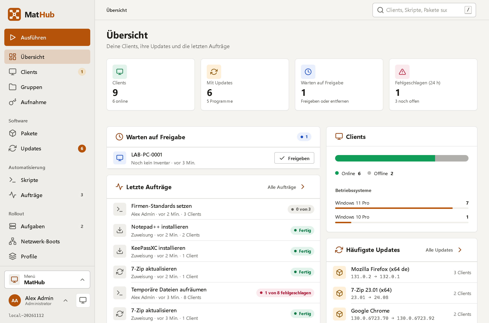
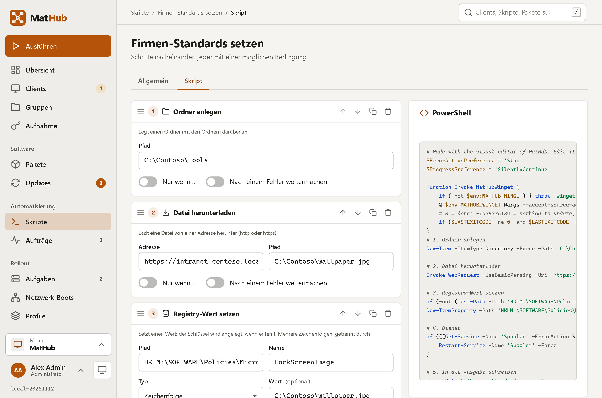
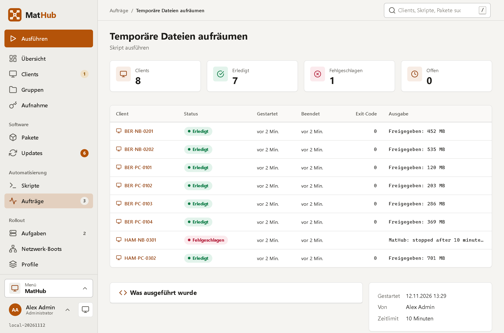
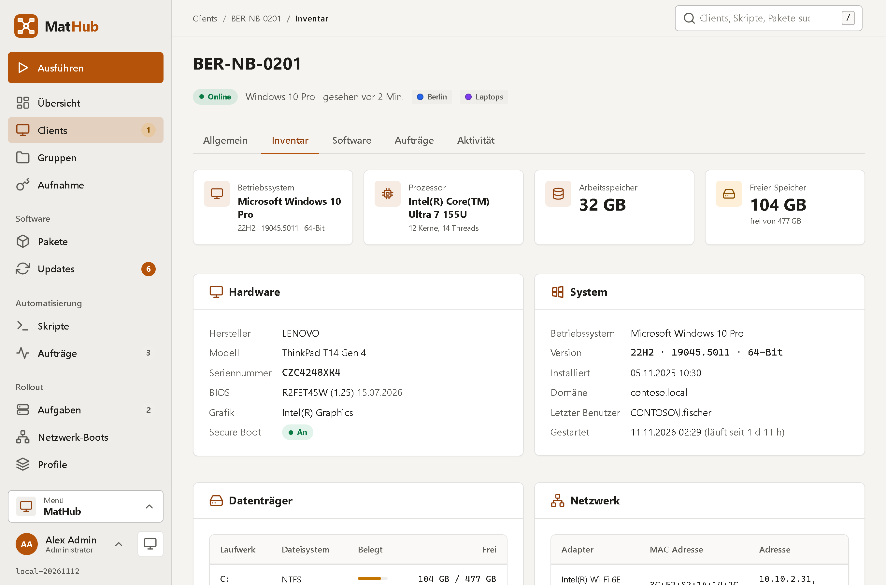

<div align="center">


# MatHub

**Client management – inventory, software and updates, scripts, rollout over the network.**

Know every Windows computer, keep its software where it belongs and up to date, run scripts written as code, put together from blocks or drawn as a flow,
and install new computers over the network. A small agent on every computer, one container plus PostgreSQL.

</div>



---

## What it does

| Area | What you get |
|---|---|
| **Overview** | The numbers that matter, each a link to its list; clients waiting for an approval (approved right there), the latest jobs, online and offline, the operating systems, the updates on the most clients |
| **Clients** | Every computer with its agent: online or not, operating system, hardware (BIOS, processor cores, graphics, Secure Boot), disks, network, uptime, the last user, the installed programs and the updates winget offers; tags, a description, run something on several at once |
| **Groups** | By hand, or by rules over the inventory (name, operating system, domain, manufacturer, model, address, tag; all of them or one of them must match) that MatHub keeps up to date; groups are the targets of jobs and assignments and the reach of roles |
| **Enrollment** | Keys for the agent (valid until, how often, the group of the new clients, approval) and one line for an elevated PowerShell that downloads, checks and installs the agent as a Windows service |
| **Packages** | winget packages, uploaded MSI and EXE installers, scripted installs; MatHub sees by the inventory whether a package is installed; a program a client has becomes a package with one click |
| **Assignments** | "The laptops have Firefox": MatHub makes the jobs that are missing every minute, checks the result in the next inventory and installs updates by itself |
| **Updates** | What winget offers, program by program and on which clients – one click updates a program everywhere, another updates everything |
| **Scripts** | PowerShell, cmd or bash in a code editor (highlighting, snippets, search, comment and duplicate lines, pairs that close themselves, full screen); steps one after the other in the block editor (each with an "only if" and "go on after an error"); a flow with branches on a canvas that zooms – the visual editors write PowerShell |
| **Jobs** | Now or at a time to come; every run on every client with its state, its exit code and everything it wrote; cancel what has not started, run the failed ones again |
| **Rollout** | PXE with iPXE and a TFTP server built in: a task names a MAC address, a computer name and a profile, and at its next network boot the computer installs Windows unattended (Windows PE through wimboot, an answer file MatHub writes), enrolls its agent and joins its group; Linux and iPXE scripts of your own too |
| **Permissions** | Roles with permissions per area, for all clients or only the members of some groups – checked in the business layer, not only on the page; MatIdentity can give roles and permissions |
| **Administration** | People, roles, connections (MatIdentity, MatSMTP), activity, system settings |

English and German, light and dark, a phone layout, and an installable app (PWA); without a network the pages you opened can still be read.

| | |
|---|---|
|  |  |
|  |  |
|  |  |
|  |  |

<p align="center"></p>

## Start

```bash
docker compose up -d          # http://localhost:4910
```

The first account that registers is the administrator. No variable is needed.

| File | Image | For |
|---|---|---|
| `docker-compose.yml` | `ghcr.io/real-ttx/mathub:latest` | Release (branch `main`) |
| `docker-compose.dev.yml` | `ghcr.io/real-ttx/mathub:nightly` | Development (branch `dev`), with pgAdmin on 4911 |
| `docker-compose.local.yml` | built from this folder | Local tests (`./scripts/redeploy.ps1`), pgAdmin 4911, PostgreSQL 4912 |

**Ports:** `4910` the pages, the API, the agents and the HTTP part of the network boot · `69/udp` the TFTP server of the network boot (in the container 4969).

## The agent

1. **Enrollment → New key** (it is shown once).
2. On the computer, in a PowerShell **as administrator**:

   ```powershell
   & ([scriptblock]::Create((irm 'https://hub.example.com/agent/install.ps1'))) -Key 'mhk_...'
   ```

The script downloads `mathub-agent.exe` (one file, .NET inside), checks its SHA-256 and runs `mathub-agent install`: the computer is enrolled, the agent is copied
to `%ProgramFiles%\MatHub Agent` and runs as the service **MatHub Agent** (LocalSystem, restarted after a crash). Its identity lies in
`%ProgramData%\MatHub Agent` (the secret encrypted with DPAPI, the folder only for SYSTEM and the administrators).

- It calls the server every 30 seconds (`/api/agent/v1/poll`), sends its inventory every 6 hours and after every change, runs its jobs one after the other and
  reports each one. There is no open port on the client.
- It updates itself to the version its server offers (the image builds both), checks the download and puts the old one back when the new one does not start.
- `mathub-agent uninstall` removes it; `mathub-agent inventory` shows what it would send.

The protocol is one source file for both sides: [`src/MatHub.Shared/AgentProtocol.cs`](src/MatHub.Shared/AgentProtocol.cs).

## The network boot

1. **DHCP**: option 66 (next-server) = the address of MatHub, option 67 = `ipxe.efi` (UEFI) or `undionly.kpxe` (BIOS). MatHub's boot loaders are iPXE with
   MatHub's script built in; they load `mathub.ipxe` over TFTP and ask MatHub over HTTP what to boot.
2. **Boot image**: Windows PE from the Windows ISO (`sources\boot.wim`, `boot\bcd` as `BCD`, `boot\boot.sdi`).
3. **Profile**: the share with the contents of the ISO (`setup.exe`), the edition, language, time zone, the administrator's password, the group of the new client.
4. **Task**: MAC address + computer name + profile. At the next network boot the computer installs itself; the next boots go to its disk, and the task is
   done when the agent of the new installation enrolls.

**Rollout → Setting up** shows what the network needs and whether the TFTP server listens. Use an account for the share that may only read it.

## Mattiverse

MatHub speaks the platform contract of the Mat family (MatDesign `docs/PLATFORM.md`, contract 2, MatPlatform 2.4): `/api`, `/api/health`, `/api/state`,
`/api/configure`, `/api/actions`, a launcher and two widgets for a shell. Everything is optional:

| Variable | What it does |
|---|---|
| `MAT_PUBLIC_URL` | The public address (the agents and mails use it); fixed on Administration → System while set |
| `MATIDENTITY_*` | Sign-in through **MatIdentity**; the claim `role` names a role (`admin`, `technician`, `operator`, `viewer`), `entitlements` add permissions |
| `MATSMTP_*` | Mail through **MatSMTP** |
| `MAT_API_KEY`, `MAT_FRAME_ANCESTORS` | The key of the platform API, the origins that may show MatHub in a frame |

## Development

```bash
dotnet build MatHub.slnx                      # 0 warnings, 0 errors
dotnet test                                   # MATHUB_TEST_DB=Host=localhost;Port=4912;Username=mathub;Password=mathub;Database=postgres for the database tests
./scripts/redeploy.ps1                        # rebuild the container and start the local stack (-Clean: empty data)
```

Versions: `<major>.<minor>.<build>-<date>` on `main`, `nightly-<build>-<date>` on `dev`, `local-<date>` everywhere else (`Directory.Build.props`;
`.github/workflows/build.yml` builds, tests and pushes the image). More in [CLAUDE.md](CLAUDE.md).

---

<sub>MatHub · part of the Mat family · made by Matthias Schmoldt</sub>
