<div align="center">


# MatHub

**Client management – inventory, software and updates, scripts, rollout over the network.**

Know every Windows computer, keep its software where it belongs and up to date, run scripts written as code, put together from blocks or drawn as a flow,
and install new computers over the network. A small agent on every computer, one container plus PostgreSQL.

</div>


---

## What it does

| Area | What you get |
|---|---|
| **Overview** | The numbers that matter, each a link to its list; clients waiting for an approval (approved right there), the latest jobs, online and offline, the operating systems, the updates on the most clients |
| **Clients** | Every computer with its agent: online or not, operating system, hardware (BIOS, processor cores, graphics, Secure Boot), disks, network, uptime, the last user, the installed programs and the updates winget offers; tags, a description, run something on several at once |
| **Groups** | By hand, or by rules over the inventory (name, operating system, domain, manufacturer, model, address, tag; all of them or one of them must match) that MatHub keeps up to date; groups are the targets of jobs and assignments and the reach of roles |
| **Enrollment** | Keys for the agent (valid until, how often, the group of the new clients, approval) and one line for an elevated PowerShell that downloads, checks and installs the agent as a Windows service |
| **Packages** | A package is the software, it has **versions**, and each version has **installers per platform** (x64, x86, ARM64 or one for all): MSI and EXE kept in MatHub, scripts, or winget with a pinned version. The agent takes the installer of its platform. MatHub sees by the inventory whether – and in which version – a client has it |
| **Approval** | A version is New, in Test (only the **pilot group** of the package gets it), Approved (every assignment gets it; the one before is retired) or Retired. Nothing that was not approved is distributed |
| **Own packages** | An assistant: upload an MSI or EXE and MatHub reads it – product, version, publisher, product code, platform, the setup it was made with (Inno, NSIS, WiX Burn, InstallShield …) and its silent switches. A new version is uploaded the same way |
| **Store** | The catalog of winget (about 16,000 programs) in MatHub, loaded every day: search, details, icon; "add" makes a package with an installer for every platform, downloaded and checked by its SHA-256 – so the clients install exactly this version from MatHub, also offline |
| **Assignments** | "The laptops have Firefox": every minute MatHub brings the approved version (the pilot group the one in test) where the package is missing or older, and removes it where an assignment says so |
| **Updates** | What waits for a test or an approval, which newer versions the catalog has (MatHub prepares them by itself – never approves them), which clients still have an older version; what winget would update beyond the packages is only shown |
| **Scripts** | PowerShell, cmd or bash in a code editor (highlighting, snippets, search, comment and duplicate lines, pairs that close themselves, full screen); steps one after the other in the block editor (each with an "only if" and "go on after an error"); a flow with branches on a canvas that zooms. Both visual editors share **one catalog of about 60 actions** and one compiler to PowerShell: programs (winget, MSI, uninstall by name), files (copy, unzip, shortcuts, rights), system (registry, services, scheduled tasks, time zone, rename), network and domain (**domain join and leave**, DNS, Wi-Fi, firewall, printers), users (local accounts and groups), Windows (updates, features, Store apps, BitLocker, Defender) and **dialogs**; values take variables (`{{serial}}`, the answers of a dialog) and those of Windows (`%ProgramData%`), and **files of the script** (`./settings.xml`: uploaded to MatHub, downloaded with every run, chosen with a button beside the field); templates to begin with; blocks become a flow with one click. **Test from the editor**: what is in it (saved or not) runs on your computer (MatHub remembers it) – as a **trial run** that changes nothing and only says what each action would do, or for real – with its output live under the editor |
| **Dialogs and wizards** | A script asks the person at the computer: a message, yes or no, a form with fields (text, password, choice, check, number) on one or more pages – a wizard with Back and Next – a notice, "please wait". The answers fill variables, an "If" branches on them; the agent shows the dialogs in the session of the person and answers "nobody" when nobody is signed in |
| **Secrets** | Passwords the scripts need (the account of a domain join, a Wi-Fi key): encrypted, never shown again, handed only to the agent of a run whose script names them, and hidden in its output |
| **Sequences** | Scripts, packages, restarts, waits, updates and an inventory one after the other, as one job: MatHub hands the agent one step at a time, waits after a restart until the computer is back, and stops at an error unless a step may fail |
| **Kiosk** | Offers the people at the computers start themselves (a script, a program, a sequence; for all clients or some groups, with a question before it starts): the window of the agent asks MatHub for them when it opens, so the list is always the current one, and shows each run until it is done |
| **Jobs** | Now or at a time to come; every run on every client with its state, its exit code and everything it wrote; cancel what has not started, run the failed ones again |
| **Rollout** | PXE with iPXE and a TFTP server built in: a task names a MAC address, a computer name and a profile, and at its next network boot the computer installs Windows unattended (Windows PE through wimboot, an answer file MatHub writes), enrolls its agent and joins its group; Linux and iPXE scripts of your own too |
| **Permissions** | Roles with permissions per area, for all clients or only the members of some groups – checked in the business layer, not only on the page; MatIdentity can give roles and permissions |
| **Administration** | People, roles, connections (MatIdentity, MatSMTP), activity, system settings |

English and German, light and dark, a phone layout, and an installable app (PWA); without a network the pages you opened can still be read.

| | |
|---|---|
|  | 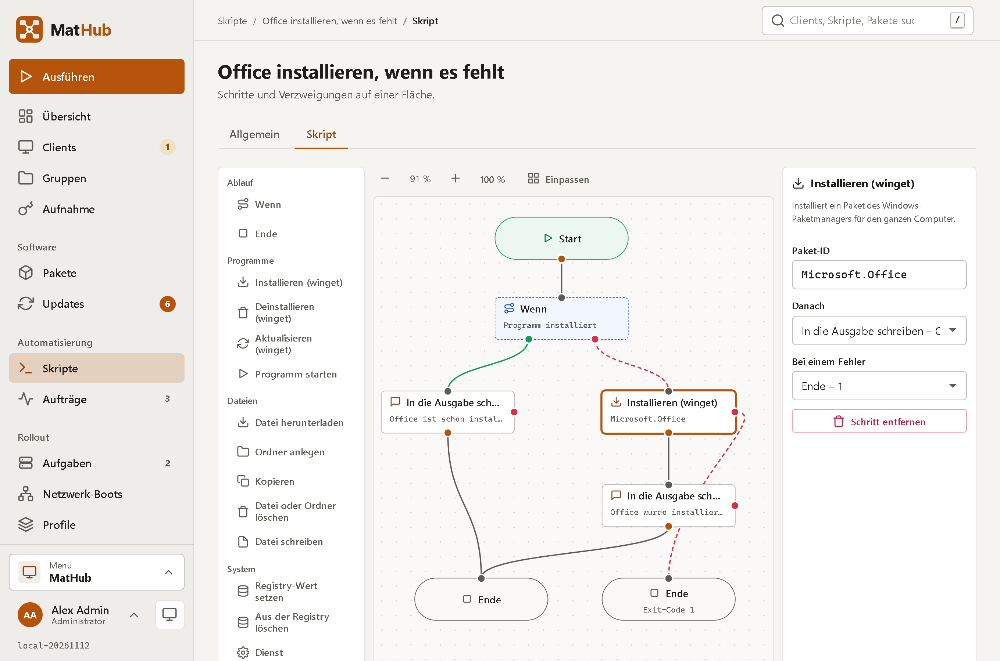 |
| 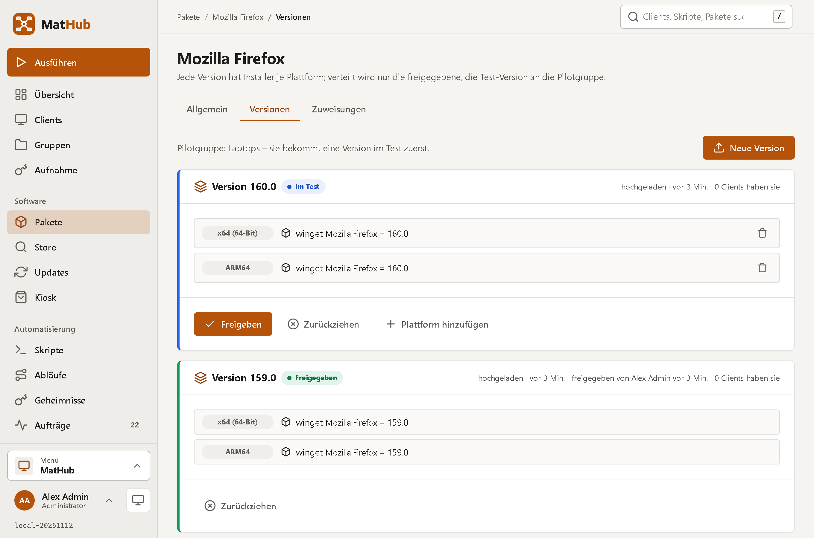 | 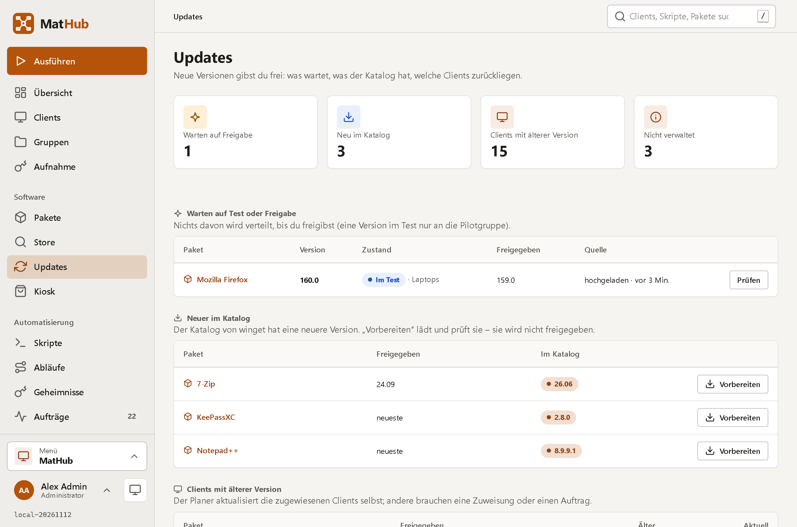 |
| 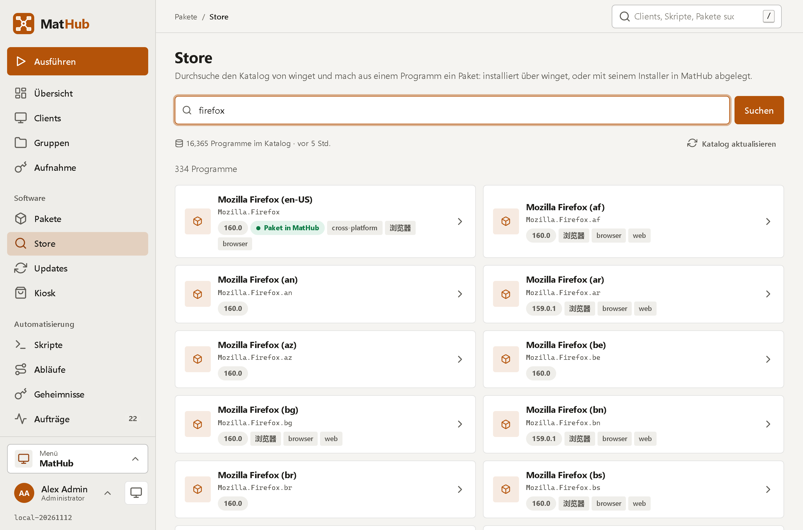 | 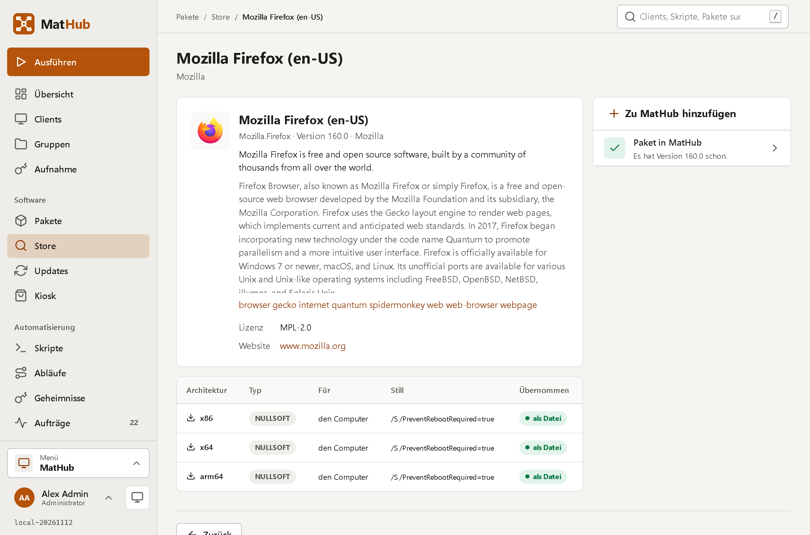 |
| 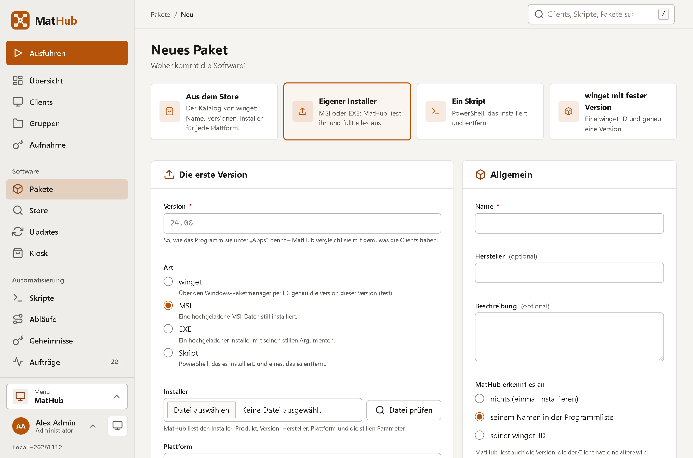 | 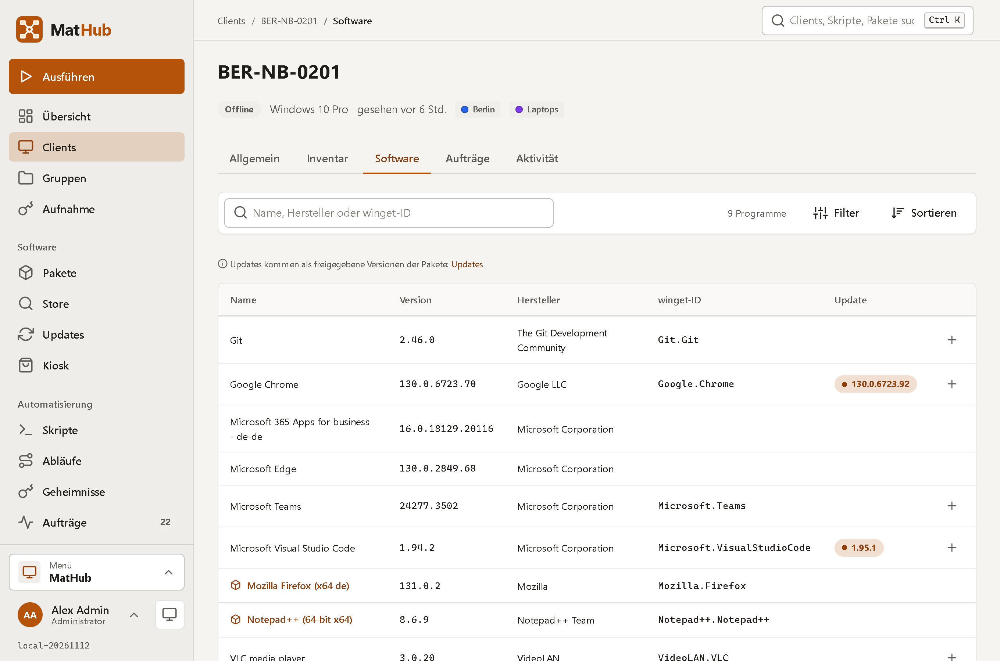 |
|  | 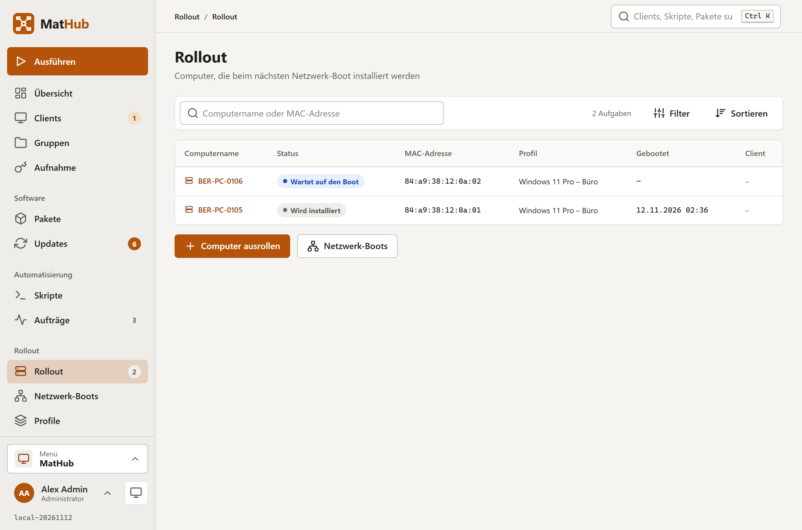 |
|  | 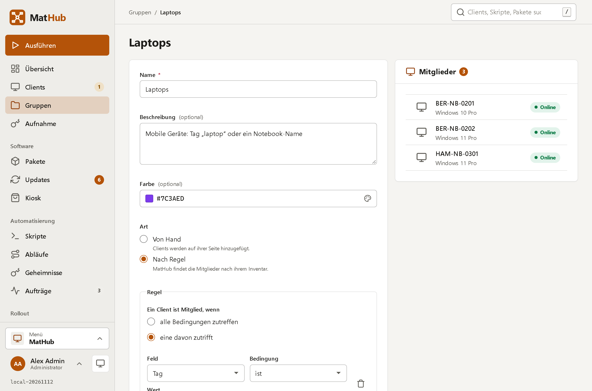 |
| 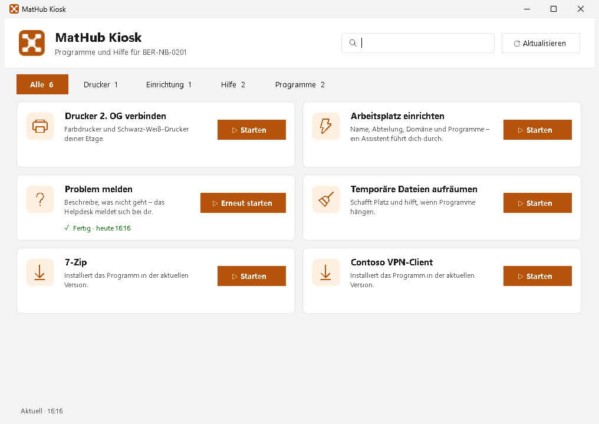 | 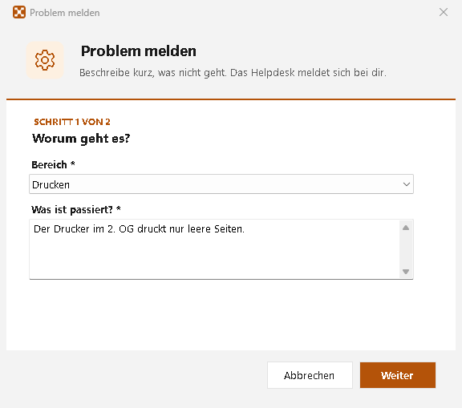 |
| 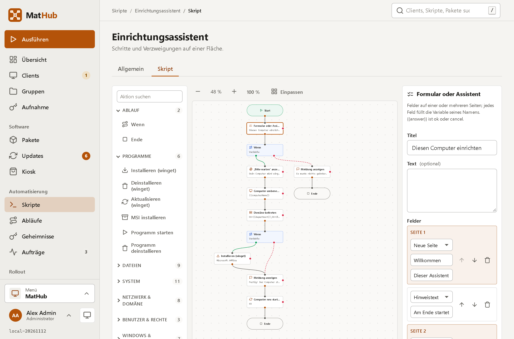 | 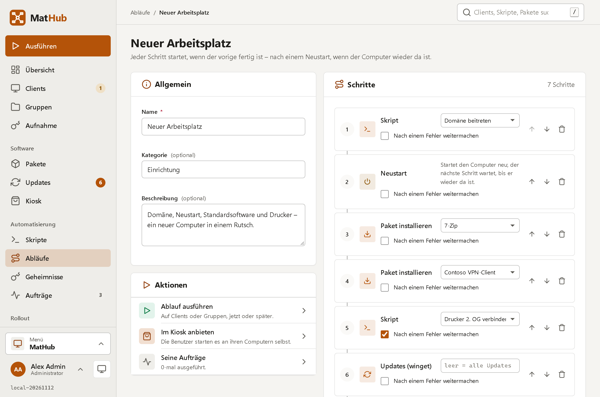 |
| 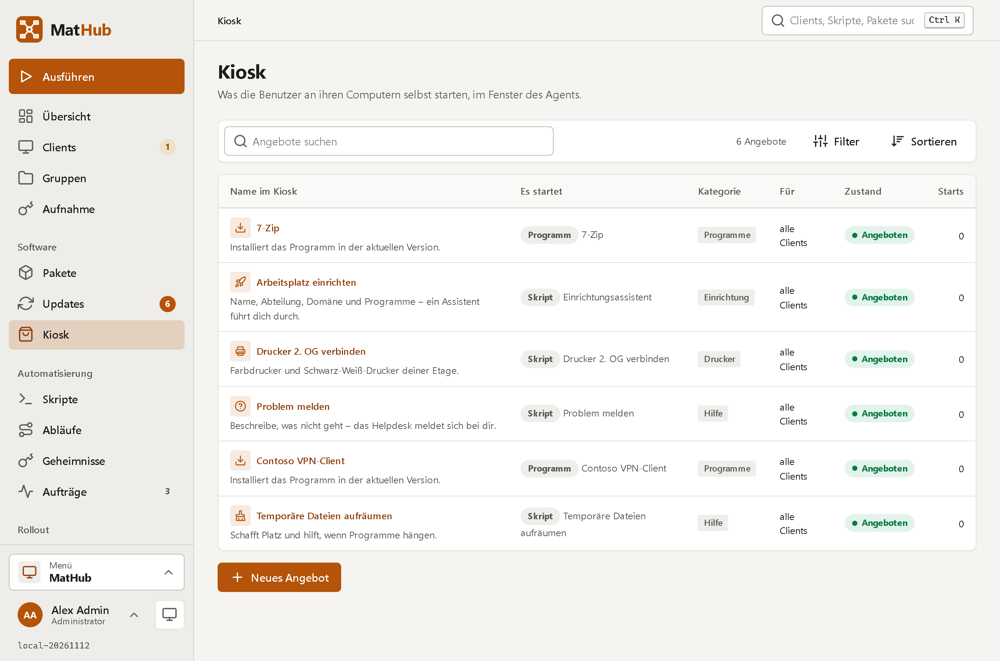 | 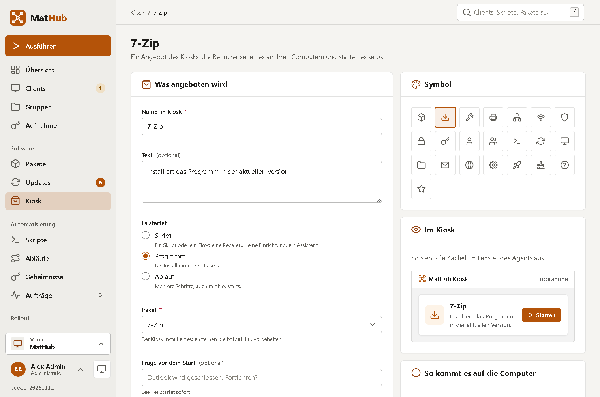 |

<p align="center">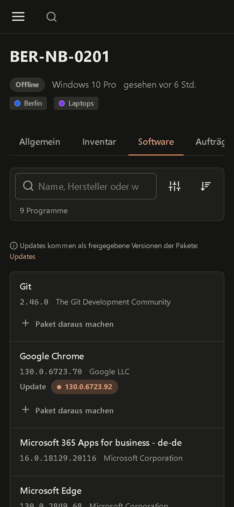</p>

## Start

```bash
docker compose up -d          # http://localhost:4910
```

The first account that registers is the administrator. No variable is needed.

| File | Image | For |
|---|---|---|
| `docker-compose.yml` | `ghcr.io/real-ttx/mathub:latest` | Release (branch `main`) |
| `docker-compose.dev.yml` | `ghcr.io/real-ttx/mathub:nightly` | Development (branch `dev`), with pgAdmin on 4911 |
| `docker-compose.local.yml` | built from this folder | Local tests (`./scripts/redeploy.ps1`), pgAdmin 4911, PostgreSQL 4912 |

**Ports:** `4910` the pages, the API, the agents and the HTTP part of the network boot · `69/udp` the TFTP server of the network boot (in the container 4969).

**Internet:** the store loads the index of winget from `cdn.winget.microsoft.com` once a day, and the installers of a program from the addresses its
publisher names in the catalog – MatHub does, and its clients take them from MatHub (only an installer of the kind winget is downloaded by the client
itself). Nothing about your clients is sent. Without the internet the store is
empty; own packages, scripts and everything else work.

## The agent

1. **Enrollment → New key** (it is shown once).
2. On the computer, in a PowerShell **as administrator**:

   ```powershell
   & ([scriptblock]::Create((irm 'https://hub.example.com/agent/install.ps1'))) -Key 'mhk_...'
   ```

The script downloads `mathub-agent.exe` (one file, .NET inside), checks its SHA-256 and runs `mathub-agent install`: the computer is enrolled, the agent is copied
to `%ProgramFiles%\MatHub Agent` and runs as the service **MatHub Agent** (LocalSystem, restarted after a crash). Its identity lies in
`%ProgramData%\MatHub Agent` (the secret encrypted with DPAPI, the folder only for SYSTEM and the administrators).

- It calls the server every 30 seconds (`/api/agent/v1/poll`), sends its inventory every 6 hours and after every change, runs its jobs one after the other and
  reports each one. There is no open port on the client.
- It updates itself to the version its server offers (the image builds both), checks the download and puts the old one back when the new one does not start.
- `mathub-agent uninstall` removes it; `mathub-agent inventory` shows what it would send.
- **The kiosk**: the install puts **MatHub Kiosk** into the start menu and starts `mathub-agent tray` at every sign-in (a symbol beside the clock). The tray
  opens the kiosk and shows the dialogs of scripts; both talk to the service through a local named pipe, so the person's process never sees the secret of
  the agent, and the service asks the server. A script shows a dialog with `mathub-agent ask` (the visual editors write that for you).
- The secrets a script names reach it as environment variables of its own process (`MATHUB_SECRET_NAME`, in PowerShell `Get-MatHubSecret 'NAME'`), and
  every place of their values in the output becomes `***`.

The protocol is one source file for both sides: [`src/MatHub.Shared/AgentProtocol.cs`](src/MatHub.Shared/AgentProtocol.cs).

## The network boot

1. **DHCP**: option 66 (next-server) = the address of MatHub, option 67 = `ipxe.efi` (UEFI) or `undionly.kpxe` (BIOS). MatHub's boot loaders are iPXE with
   MatHub's script built in; they load `mathub.ipxe` over TFTP and ask MatHub over HTTP what to boot.
2. **Boot image**: Windows PE from the Windows ISO (`sources\boot.wim`, `boot\bcd` as `BCD`, `boot\boot.sdi`).
3. **Profile**: the share with the contents of the ISO (`setup.exe`), the edition, language, time zone, the administrator's password, the group of the new client.
4. **Task**: MAC address + computer name + profile. At the next network boot the computer installs itself; the next boots go to its disk, and the task is
   done when the agent of the new installation enrolls.

**Rollout → Setting up** shows what the network needs and whether the TFTP server listens. Use an account for the share that may only read it.

## Mattiverse

MatHub speaks the platform contract of the Mat family (MatDesign `docs/PLATFORM.md`, contract 2, MatPlatform 2.4): `/api`, `/api/health`, `/api/state`,
`/api/configure`, `/api/actions`, a launcher and two widgets for a shell. Everything is optional:

| Variable | What it does |
|---|---|
| `MAT_PUBLIC_URL` | The public address (the agents and mails use it); fixed on Administration → System while set |
| `MATIDENTITY_*` | Sign-in through **MatIdentity**; the claim `role` names a role (`admin`, `technician`, `operator`, `viewer`), `entitlements` add permissions |
| `MATSMTP_*` | Mail through **MatSMTP** |
| `MAT_API_KEY`, `MAT_FRAME_ANCESTORS` | The key of the platform API, the origins that may show MatHub in a frame |

## Development

```bash
dotnet build MatHub.slnx                      # 0 warnings, 0 errors
dotnet test                                   # MATHUB_TEST_DB=Host=localhost;Port=4912;Username=mathub;Password=mathub;Database=postgres for the database tests
./scripts/redeploy.ps1                        # rebuild the container and start the local stack (-Clean: empty data)
```

Versions: `<major>.<minor>.<build>-<date>` on `main`, `nightly-<build>-<date>` on `dev`, `local-<date>` everywhere else (`Directory.Build.props`;
`.github/workflows/build.yml` builds, tests and pushes the image). More in [CLAUDE.md](CLAUDE.md).

---

<sub>MatHub · part of the Mat family · made by Matthias Schmoldt</sub>
